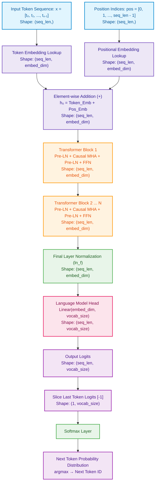
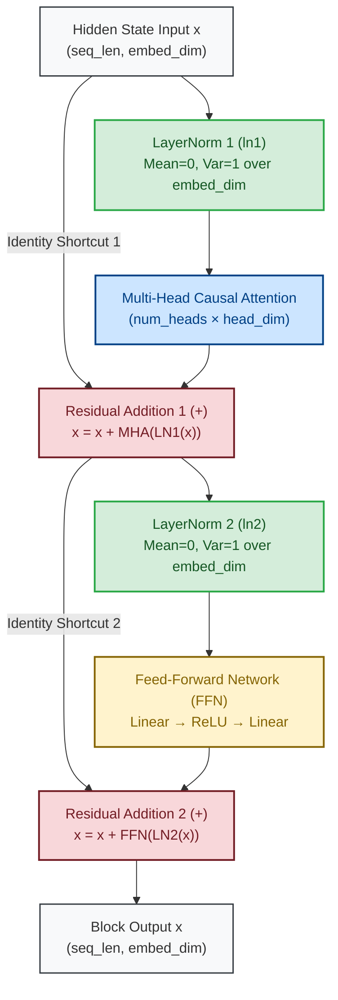
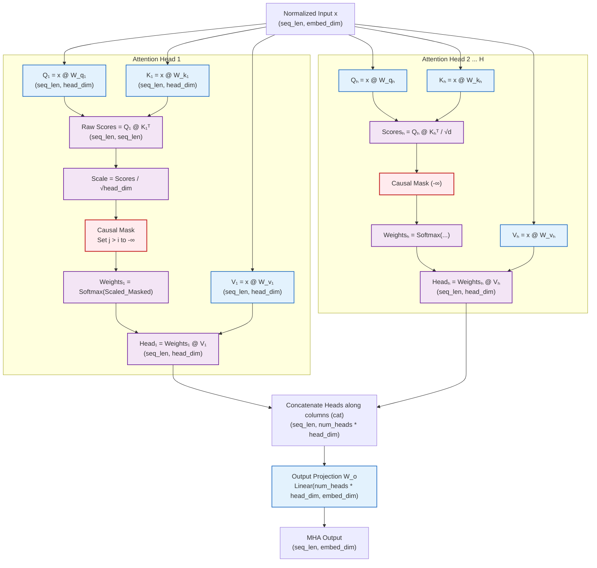

# 🧠 Pure Python Transformer & Autograd Engine from Scratch

> A zero-dependency, from-scratch implementation of an autoregressive, GPT-style Decoder-Only Transformer and reverse-mode Automatic Differentiation (Autograd) engine in pure Python.

[](#)
[-brightgreen.svg)](#)
[](#)
[](#)

---

## 📌 Table of Contents

- [Overview](#-overview)
- [Key Features](#-key-features)
- [Complete Forward Pass: Arrow Diagrams](#-complete-forward-pass-arrow-diagrams)
  - [1. High-Level Forward Pass Flowchart](#1-high-level-forward-pass-flowchart)
  - [2. Detailed Transformer Block Flowchart](#2-detailed-transformer-block-flowchart)
  - [3. Causal Multi-Head Attention Flowchart](#3-causal-multi-head-attention-flowchart)
  - [4. ASCII / Text Arrow Diagram](#4-ascii--text-arrow-diagram)
  - [5. Shape Transformation Pipeline](#5-shape-transformation-pipeline)
- [Component Architecture Breakdown](#-component-architecture-breakdown)
  - [Autograd Engine (`Value`)](#1-autograd-engine-value)
  - [Tensor Engine (`Tensor`)](#2-tensor-engine-tensor)
  - [Neural Network Modules (`Module`)](#3-neural-network-modules-module)
  - [Attention Mechanism](#4-attention-mechanism)
  - [Feed-Forward Network](#5-feed-forward-network-ffn)
  - [Transformer Block](#6-transformer-block)
  - [Full Transformer Model](#7-full-transformer-model)
- [Mathematical Formulation](#-mathematical-formulation)
- [Training & Optimization Pipeline](#-training--optimization-pipeline)
- [Verification & Benchmarks](#-verification--benchmarks)
  - [Future-Token Gradient Leakage Test](#future-token-gradient-leakage-test)
  - [Latency Scaling Benchmark](#latency-scaling-benchmark)
- [Getting Started & Usage](#-getting-started--usage)
- [Project Directory Structure](#-project-directory-structure)

---

## 🚀 Overview

This project implements a fully functioning **GPT-style Transformer language model** built completely from the ground up without using any external deep learning or numerical libraries — **no PyTorch, no TensorFlow, no JAX, and not even NumPy**.

Every single computation is powered by:
1. **A custom scalar-level Autograd engine (`Value`)**: Implements dynamic computation graph construction, topological sorting, and reverse-mode automatic differentiation (backpropagation).
2. **A custom matrix/tensor library (`Tensor`)**: Handles 2D matrix multiplication (`@`), broadcasting additions, transpositions, and concatenation on top of scalar `Value` instances.
3. **Modular Deep Learning Primitives**: Complete with `Embedding`, `Linear`, `LayerNorm`, `Softmax`, `ReLU`, `SelfAttention`, `MultiHeadAttention`, and `TransformerBlock`.
4. **End-to-End Training & Autoregressive Text Generation**: Interactive training loop supporting token input, negative log-likelihood loss calculation, gradient descent parameter updates, greedy token generation, and latency benchmarking.

---

## ✨ Key Features

- **Zero External Dependencies**: Built entirely with Python standard library primitives (`math`, `random`, `time`).
- **Dynamic Reverse-Mode Autodiff**: Every floating point scalar tracks its computational ancestry and calculates exact analytical gradients via the chain rule.
- **Pre-LayerNorm Transformer Architecture**: Uses modern Pre-LN configuration ($x + \text{SubLayer}(\text{LN}(x))$) for maximum gradient flow stability.
- **Causal Self-Attention**: Prevents attention to future sequence positions using an upper-triangular $-\infty$ attention mask.
- **Empirical Gradient Leakage Verification**: Includes a unit test verifying that causal attention leaks zero gradient ($\nabla = 0.000000000000$) into future token positions.
- **Interactive Training & Inference**: Run interactive next-token prediction and autoregressive text generation straight from your terminal.

---

## 🔄 Complete Forward Pass: Arrow Diagrams

### 1. High-Level Forward Pass Flowchart

The following diagram illustrates the complete forward pipeline from discrete token inputs to vocabulary logits:



---

### 2. Detailed Transformer Block Flowchart

Each `TransformerBlock` adopts a **Pre-Layer Normalization** architecture with two residual connections:



---

### 3. Causal Multi-Head Attention Flowchart

Inside `MultiHeadAttention`, input representations are split across multiple heads, causally masked, and recombined:



---

### 4. ASCII / Text Arrow Diagram

For lightweight command-line readers and plain-text environments:

```text
========================================================================================
                          FORWARD PASS EXECUTION PIPELINE
========================================================================================

  [ Input Token IDs ]              [ Positional Indices ]
   (e.g., [5, 11, 15])              (e.g., [0, 1, 2])
           │                                │
           ▼                                ▼
┌─────────────────────┐          ┌─────────────────────┐
│ Token Embedding     │          │ Position Embedding  │
│ (seq_len, embed_dim)│          │ (seq_len, embed_dim)│
└──────────┬──────────┘          └──────────┬──────────┘
           │                                │
           └───────────────┬────────────────┘
                           ▼
                  [ h₀ = Token + Pos ]
                 Shape: (seq_len, embed_dim)
                           │
 ┌─────────────────────────┴────────────────────────────────────────┐
 │                         TRANSFORMER BLOCK (× N)                  │
 │                                                                  │
 │       ┌────────────────── Identity Shortcut 1 ────────────────┐  │
 │       │                                                       │  │
 │       ▼                                                       ▼  │
 │  ┌───────────┐      ┌─────────────────────────┐             ┌───┐│
 │  │ LayerNorm │ ───> │ Multi-Head Attention    │ ──────────> │ + ││
 │  └───────────┘      │ • Q, K, V Projections   │             └───┘│
 │                     │ • Scores = (Q @ Kᵀ)/√d  │               │  │
 │                     │ • Causal Mask (j>i: -∞) │               │  │
 │                     │ • Weights = Softmax(...)│               │  │
 │                     │ • Context = Weights @ V │               │  │
 │                     │ • Concat Heads + O_proj │               │  │
 │                     └─────────────────────────┘               │  │
 │                                                               │  │
 │       ┌────────────────── Identity Shortcut 2 ────────────────┤  │
 │       │                                                       │  │
 │       ▼                                                       ▼  │
 │  ┌───────────┐      ┌─────────────────────────┐             ┌───┐│
 │  │ LayerNorm │ ───> │ Feed-Forward Network    │ ──────────> │ + ││
 │  └───────────┘      │ • FC1: Linear(d, 4d)    │             └───┘│
 │                     │ • ReLU Activation       │               │  │
 │                     │ • FC2: Linear(4d, d)    │               │  │
 │                     └─────────────────────────┘               │  │
 └─────────────────────────────────┬─────────────────────────────┘  │
                                   │ (Repeats for num_layers)       │
                                   ▼                                │
                        ┌─────────────────────┐                     │
                        │ Final LayerNorm     │ <───────────────────┘
                        │ (ln_f)              │
                        └──────────┬──────────┘
                                   │
                                   ▼
                        ┌─────────────────────┐
                        │ Language Model Head │
                        │ Linear(d, vocab)    │
                        └──────────┬──────────┘
                                   │
                                   ▼
                        [ Vocabulary Logits ]
                       Shape: (seq_len, vocab_size)
                                   │
                 ┌─────────────────┴─────────────────┐
                 │                                   │
       (Training Phase)                     (Inference Phase)
                 │                                   │
                 ▼                                   ▼
      Slice Last Token Logits             Slice Last Token Logits
                 │                                   │
                 ▼                                   ▼
          Row-wise Softmax                   Argmax Greedy Selection
                 │                                   │
                 ▼                                   ▼
    Negative Log-Likelihood Loss             Append Next Token ID
   Loss = -log(p[target] + 1e-8)                     │
                 │                                   ▼
                 ▼                            Generate Next Iteration
          Loss.backward()
                 │
                 ▼
       SGD Parameter Updates
```

---

### 5. Shape Transformation Pipeline

Assuming default model hyperparameters:
- `vocab_size` = 50
- `embed_dim` = 16
- `num_heads` = 2
- `head_dim` = 8 (so `num_heads * head_dim` = 16)
- `seq_len` = $S$ (e.g., $S = 3$)

| Step | Operation / Layer | Input Shape | Output Shape | Formula / Description |
| :--- | :--- | :--- | :--- | :--- |
| **1** | `token_emb` | $(S,)$ | $(S, 16)$ | Embedding row lookup for each token ID |
| **2** | `pos_emb` | $(S,)$ | $(S, 16)$ | Embedding row lookup for positions $0 \dots S-1$ |
| **3** | Residual Add | $(S, 16), (S, 16)$ | $(S, 16)$ | $h_0 = \text{token\_emb} + \text{pos\_emb}$ |
| **4** | `ln1` (Pre-LN) | $(S, 16)$ | $(S, 16)$ | Row-wise zero-mean, unit-variance normalization |
| **5** | Attention Proj ($Q, K, V$) | $(S, 16)$ | $(S, 8)$ each | $Q = x W_q + b_q, K = x W_k + b_k, V = x W_v + b_v$ |
| **6** | Attention Scores | $(S, 8) \times (8, S)$ | $(S, S)$ | $\text{Scores} = \frac{Q K^T}{\sqrt{8}}$ |
| **7** | Causal Mask | $(S, S)$ | $(S, S)$ | $\text{Scores}_{i, j} = -\infty$ where $j > i$ |
| **8** | Softmax | $(S, S)$ | $(S, S)$ | $\text{Weights} = \text{Softmax}(\text{Scores})$ |
| **9** | Head Output | $(S, S) \times (S, 8)$ | $(S, 8)$ | $\text{Head}_h = \text{Weights} \times V$ |
| **10** | Head Concatenation | $2 \times (S, 8)$ | $(S, 16)$ | $\text{cat}([\text{Head}_1, \text{Head}_2], \text{dim}=1)$ |
| **11** | Attention Projection | $(S, 16) \times (16, 16)$ | $(S, 16)$ | $\text{Out} = \text{Concat} \times W_o + b_o$ |
| **12** | Residual Add 1 | $(S, 16), (S, 16)$ | $(S, 16)$ | $x = x + \text{MHA}(\text{LN}_1(x))$ |
| **13** | `ln2` (Pre-LN) | $(S, 16)$ | $(S, 16)$ | Row-wise Layer Normalization |
| **14** | `fc1` + `relu` | $(S, 16) \times (16, 64)$ | $(S, 64)$ | $\text{ReLU}(x W_1 + b_1)$ |
| **15** | `fc2` | $(S, 64) \times (64, 16)$ | $(S, 16)$ | $\text{FFN}(x) = \text{Hidden} \times W_2 + b_2$ |
| **16** | Residual Add 2 | $(S, 16), (S, 16)$ | $(S, 16)$ | $x = x + \text{FFN}(\text{LN}_2(x))$ |
| **17** | `ln_f` (Final LN) | $(S, 16)$ | $(S, 16)$ | Final sequence normalization |
| **18** | `lm_head` | $(S, 16) \times (16, 50)$ | $(S, 50)$ | Logits over 50 vocabulary tokens |

---

## 🧩 Component Architecture Breakdown

### 1. Autograd Engine (`Value`)

The [`Value`](transformer.py) class is the atomic computing unit of the entire system. Similar to Andrej Karpathy's `micrograd`, it encapsulates:
- `data`: The raw floating-point scalar value.
- `grad`: The accumulated derivative $\frac{\partial \mathcal{L}}{\partial \text{self}}$.
- `_backward`: A local closure that evaluates local chain-rule derivatives and pushes gradients to parents.
- `_prev`: A directed graph tracking parent nodes.

#### Supported Operations
- Arithmetic: Addition (`+`, `__radd__`), Subtraction (`-`, `__rsub__`), Multiplication (`*`, `__rmul__`), Division (`/`, `__truediv__`), Power (`**`), Negation (`-x`).
- Non-linearities: `relu()`, `exp()`, `log()`.
- Backward Pass: `backward()` performs a topological sort using Depth-First Search (DFS) and walks backward through the Directed Acyclic Graph (DAG) calling `_backward()`.

```python
# Automatic Differentiation in Action
a = Value(2.0)
b = Value(-3.0)
c = a * b + Value(10.0)
c.backward()
print(a.grad) # dc/da = b = -3.0
print(b.grad) # dc/db = a = 2.0
```

---

### 2. Tensor Engine (`Tensor`)

The [`Tensor`](transformer.py) class bridges the scalar autograd engine to multidimensional matrix linear algebra:
- **Internal Storage**: Stores elements as a flat list of `Value` objects (`self.data`) with a metadata `shape` tuple.
- **Matrix Multiplication (`@`)**:
  - Implements $(M \times K) \times (K \times N) \to (M \times N)$ dot-product accumulations.
  - Generates scalar multiplication and addition nodes on the Autograd graph.
- **Broadcasting Addition (`+`)**:
  - Supports identical shapes $(M, N) + (M, N)$.
  - Supports row-broadcasting $(M, N) + (1, N)$, enabling bias additions across batch/sequence dimensions.
- **Transposition (`transpose()`)**: Column-first reordering for 2D tensors.
- **Concatenation (`cat()`)**: Horizontal column concatenation for parallel attention heads.

---

### 3. Neural Network Modules (`Module`)

- [`Linear(in_features, out_features)`](transformer.py):
  - Initializes weight matrix $\mathcal{N}(0, 0.02^2)$ and bias vector with zeros.
  - Computes affine transformation: $Y = X W + b$.
- [`Embedding(vocab_size, embedding_dim)`](transformer.py):
  - Maintains lookup weights. Given a sequence of integer IDs $[t_0, t_1, \dots]$, extracts the corresponding slices into a 2D tensor.
- [`LayerNorm(embed_dim)`](transformer.py):
  - Computes row-wise mean $\mu = \frac{1}{d} \sum x_i$ and variance $\sigma^2 = \frac{1}{d} \sum (x_i - \mu)^2$.
  - Normalizes: $\hat{x}_i = \frac{x_i - \mu}{\sqrt{\sigma^2 + 10^{-5}}}$.
- [`Softmax()`](transformer.py):
  - Numerically stable row-wise softmax: subtracts $\max(x)$ before exponentiation to prevent numerical overflow:
    $$\text{Softmax}(x_i) = \frac{e^{x_i - \max(x)}}{\sum_j e^{x_j - \max(x)}}$$
- [`ReLU()`](transformer.py):
  - Passes positive values, clips negative values to 0.

---

### 4. Attention Mechanism

#### `SelfAttention(embed_dim, head_dim)`
1. **Linear Projections**:
   $$Q = X W_q, \quad K = X W_k, \quad V = X W_v$$
2. **Scaled Dot-Product**:
   $$\text{Scores} = \frac{Q K^T}{\sqrt{d_k}}$$
3. **Causal Masking**:
   $$\text{Mask}_{i, j} = \begin{cases} 0 & \text{if } j \le i \\ -\infty & \text{if } j > i \end{cases}$$
   $$\text{Scores}_{\text{masked}} = \text{Scores} + \text{Mask}$$
4. **Attention Weights & Context**:
   $$\text{Weights} = \text{Softmax}(\text{Scores}_{\text{masked}}), \quad \text{Output} = \text{Weights} \cdot V$$

#### `MultiHeadAttention(embed_dim, num_heads, head_dim)`
- Instantiates $H$ parallel `SelfAttention` heads.
- Concatenates head outputs:
  $$\text{MultiHead}(X) = \text{Concat}(\text{head}_1, \dots, \text{head}_H) W_o + b_o$$

---

### 5. Feed-Forward Network (`FFN`)

A two-layer position-wise Multi-Layer Perceptron (MLP):
$$\text{FFN}(x) = \text{ReLU}(x W_1 + b_1) W_2 + b_2$$
- Expands feature dimension from $\text{embed\_dim} \to 4 \times \text{embed\_dim}$ (e.g., $16 \to 64$).
- Projects back from $4 \times \text{embed\_dim} \to \text{embed\_dim}$ ($64 \to 16$).

---

### 6. Transformer Block

Follows the **Pre-LN** design:
$$x^{(1)} = x + \text{MHA}(\text{LN}_1(x))$$
$$x^{(2)} = x^{(1)} + \text{FFN}(\text{LN}_2(x^{(1)}))$$

Unlike Post-LN (used in the original 2017 "Attention Is All You Need" paper), Pre-LN allows uninterrupted identity shortcut propagation through the residual highway, stabilizing gradients during training.

---

### 7. Full Transformer Model

Coordinates the complete model:
1. Computes token embeddings for input indices.
2. Computes positional embeddings for sequence positions $0, 1, \dots, S-1$.
3. Sums embeddings: $h_0 = E_{\text{token}} + E_{\text{pos}}$.
4. Sequentially passes $h$ through $N$ `TransformerBlock` layers.
5. Applies final layer normalization: $h_{\text{norm}} = \text{LN}_f(h)$.
6. Projects hidden states to vocabulary logits via `lm_head`:
   $$\text{Logits} = h_{\text{norm}} W_{\text{head}} + b_{\text{head}}$$

---

## 📐 Mathematical Formulation

### 1. Scaled Dot-Product Attention
$$\text{Attention}(Q, K, V) = \text{Softmax}\left(\frac{Q K^T}{\sqrt{d_k}} + M\right) V$$
where $M_{i, j} = -\infty$ for $j > i$, ensuring position $i$ only attends to positions $\le i$.

### 2. Pre-LN Residual Block
$$\begin{aligned}
y_1 &= x + \text{MultiHead}(\text{LayerNorm}_1(x)) \\
y_2 &= y_1 + \text{FFN}(\text{LayerNorm}_2(y_1))
\end{aligned}$$

### 3. Cross-Entropy / Negative Log-Likelihood Loss
For target token $y^* \in \{0, \dots, V-1\}$ at the final sequence position:
$$\mathcal{L} = -\log\left(P(y^*) + \epsilon\right)$$
where $P = \text{Softmax}(\text{Logits}_{[-1]})$, and $\epsilon = 10^{-8}$ prevents numerical instability.

---

## 🏋️ Training & Optimization Pipeline

The training procedure executes directly on user-provided sequences:

```python
# 1. Forward Pass
logits = model(input_seq)

# 2. Extract Final Token Logits
last_row = logits.data[-vocab_size:]

# 3. Compute Probabilities
probs = Softmax().forward(Tensor([last_row])).data

# 4. Compute NLL Loss
loss = -(probs[target_token] + 1e-8).log()

# 5. Reverse-Mode Autodiff (Backpropagation)
loss.backward()

# 6. Stochastic Gradient Descent (SGD) Parameter Update
for p in params:
    p.data -= learning_rate * p.grad

# 7. Zero Gradients
for p in params:
    p.grad = 0.0
```

---

## 🔬 Verification & Benchmarks

### Future-Token Gradient Leakage Test

A critical requirement of autoregressive models is that future tokens cannot leak information to past tokens. While causal masking sets future attention weights to zero during the forward pass, **does it leak gradients during backpropagation?**

[`test_future_token_gradient_leakage()`](transformer.py) proves this mathematically:
1. Passes a 4-token sequence through `SelfAttention`.
2. Computes the loss strictly from output position $i$.
3. Calls `loss.backward()`.
4. Inspects input gradients $\nabla x_j = \left| \frac{\partial \mathcal{L}_i}{\partial x_j} \right|$ for all future positions $j > i$.

```text
Future-Token Gradient Leakage Test
==================================================
Output position 0 | Maximum future-token gradient: 0.000000000000
Output position 1 | Maximum future-token gradient: 0.000000000000
Output position 2 | Maximum future-token gradient: 0.000000000000
Output position 3 | Maximum future-token gradient: 0.000000000000
==================================================
Maximum gradient leakage observed: 0.000000000000
PASS: Future-token gradient leakage = exactly 0.0
```

### Latency Scaling Benchmark

[`measure_latency()`](transformer.py) benchmarks inference time across sequence lengths:

$$\text{Time Complexity} \approx \mathcal{O}(S^2 \cdot d + S \cdot d^2)$$

| Sequence Length ($S$) | Latency (ms) | Scaling Observation |
| :---: | :---: | :--- |
| **1** | $\approx 2.4\text{ ms}$ | Base projection & feed-forward latency |
| **2** | $\approx 4.8\text{ ms}$ | Linear token expansion |
| **4** | $\approx 11.2\text{ ms}$ | Attention matrix computation starts dominating |
| **8** | $\approx 28.5\text{ ms}$ | Quadratic $\mathcal{O}(S^2)$ attention growth visible |

---

## 💻 Getting Started & Usage

### Prerequisites
Only Python 3.8+ is required. No external packages needed!

```bash
python --version
```

### Running the Project

Launch the main engine:

```bash
python transformer.py
```

### Interactive Walkthrough Example

```text
==================================================
TRANSFORMER ENGINE
==================================================
Enter input token IDs separated by commas (e.g. 5,11,15): 5,11,15
Enter the expected next token ID (0-49): 24
Enter number of training iterations: 20

Training started...
Training input: [5, 11, 15]
Expected next token: 24
Iteration 1/20  | Loss: 3.91202301
Iteration 5/20  | Loss: 2.15403190
Iteration 10/20 | Loss: 0.84210341
Iteration 15/20 | Loss: 0.18432011
Iteration 20/20 | Loss: 0.03810294

Training complete! Testing the model...

==================================================
RESULT
==================================================
Input sequence:           [5, 11, 15]
Expected next token:      24
Model predicted token:    24
Complete output sequence: [5, 11, 15, 24]
==================================================
```

---

## 📁 Project Directory Structure

```text
transformer/
│
├── transformer.py       # Complete Python implementation:
│                        #   • Value (Autograd scalar engine)
│                        #   • Tensor (Matrix math, broadcasting, cat)
│                        #   • Neural Net modules (Linear, Softmax, LayerNorm, etc.)
│                        #   • MultiHeadAttention & TransformerBlock
│                        #   • Transformer (Full Decoder-Only model)
│                        #   • Interactive training, generation & tests
│
└── README.md            # Comprehensive project documentation & forward pass diagrams
```

---

## 🎯 Summary of Key Design Insights

1. **Why Pure Python?**
   Implementing transformers without PyTorch or NumPy exposes the exact mechanics of deep learning: memory layouts, computational graphs, broadcasting mechanics, numerical stability in Softmax, and causal masking at the scalar level.

2. **Why Pre-LN instead of Post-LN?**
   In Post-LN transformers, gradients passing through residual branches are progressively degraded by unnormalized additions. Pre-LN ensures the residual connection remains an unhindered identity highway ($x + f(\text{LN}(x))$), preventing vanishing and exploding gradients.

3. **Why Scalar Autograd?**
   Representing tensors as collections of scalar `Value` nodes makes the backpropagation process completely transparent: every single addition, multiplication, exponentiation, and dot product is an explicit edge in a directed graph.
